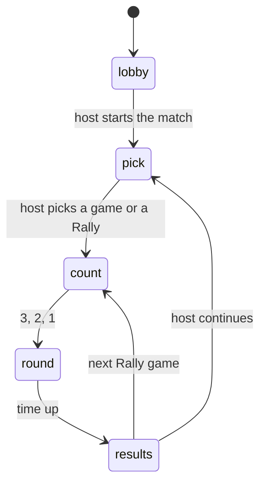

# Word Rally: design brief

> Three quick word games against the clock, behind one hub: trace words through a grid (Tangle), race to crack a hidden five-letter word (Lockword), and build words from seven letters (Petal). Play alone for a best score, or host a room and battle friends live.

*Status: shipped · Version: 1.3.0*

## Kickoff
| Topic | Answer |
|---|---|
| Concept / genre | A collection of timed word games, solo or multiplayer (the request) |
| Games in v1 | Tangle, Lockword, Petal. Later: Rungs (word ladder), Jumble (unscramble race), Hunt (word search race) |
| 2D or 3D | 2D canvas (assumption: nothing here needs depth) |
| Art style | "Game night": dark indigo, chunky cream letter tiles with a hard drop edge, one bright colour per game (chosen from mockups over a bolder game-show option) |
| Players | Solo, or 2 to 8 online with one device each. Friends only: host a room, friends join it from the list. No quick match |
| Devices | Phone, handheld and desktop. One fill-the-screen space whose short side is 720; a tall layout for a phone held upright and a wide one for Deck, desktop and a phone on its side. Labels it should earn: Handheld & controller, Desktop, Tablet, Phone |
| Feel | Tense race, clever finds, big reveals between rounds |
| Solo | Against the clock for a personal best per game. No daily puzzle, no computer rivals |
| Session | Rounds of about two minutes; a Rally (all three) is about eight |
| Assumptions | Name "Word Rally"; lives in this workshop; reuses Wordfront's MIT word list; sound is punchy arcade blips with no music for now; names online come from a preset list because a controller can't type |

## Fun targets
- **Challenge (primary):** the clock, live rival scores, a red ticking final ten seconds.
- **Discovery ("aha"):** points rise steeply with length (3 letters 1, 4: 2, 5: 4, 6: 7, 7: 11, 8+: 16), a word only you found scores double, Petal pays +10 for using all seven letters.
- **Fellowship:** after each round everyone sees who took it, the best word, the words only they found and what they missed.

## The games
| | Tangle | Lockword | Petal |
|---|---|---|---|
| Goal | Most points from words traced through touching tiles of a 4×4 grid | Crack as many hidden words as you can, up to 6 guesses each; everyone gets the same words in the same order | Most points from words made of 7 letters, always using the middle one |
| Length | 120 s | 180 s | 120 s |
| Scoring | By length; ×2 if only you found it | 20 + 5 per unused guess for a solved word; −10 for a word missed or skipped | By length (4+); +10 for all seven; ×2 if only you found it |
| Hidden | Rivals' words until the round ends | The answers stay on the host; a player is told a word only once they have finished it; rivals see colours, never letters | Rivals' words until the round ends |

A match is a run of games the host picks one at a time, or a **Rally** (all three in a random order). Online, the winner of each game takes 100 match points and everyone else their share. Alone, the total is simply the points scored.

## The 8 formal elements
| Element | This game |
|---|---|
| Players | 1, or 2 to 8 online, every player on their own device, all against all |
| Objectives | Outscore the room (or your best) before the clock runs out |
| Procedures | Pick letters, play a word, undo, clear, shuffle (Petal), type and enter a guess (Lockword) |
| Rules | Words must be in the bundled dictionary and fit the puzzle; each word counts once per player |
| Resources | Time, and in Lockword six guesses |
| Conflict | The clock, and other players' live scores |
| Boundaries | One screen per game; a round's puzzle is the same for everyone |
| Outcome | A results table after every round, standings between games; solo ends on a results screen with your best |

## Controls
| | Controller | Keyboard | Mouse / touch |
|---|---|---|---|
| Tangle | D-pad moves, A picks (A again on the last tile plays), X plays, B undoes, Y clears | Same with arrows / WASD, Space, Shift, Backspace, F | Drag across letters and let go; or tap tiles, tapping the last one again to play |
| Petal | Stick steps between petals, A adds, X plays, B deletes, Y shuffles | Type the word, Enter plays, Backspace deletes | Tap petals; Delete / Shuffle / Enter buttons |
| Lockword | D-pad moves over the on-screen keyboard, A types, X enters, B deletes, Y skips the word | Type the guess, Enter, Backspace; F skips | Tap the on-screen keys and the Skip button |

Start / Esc / the on-screen button pause. Alone the clock stops; online only your own controls stop and the pause screen says so.

## How it is built
- `words.js`: dictionary, puzzle makers, validation, scoring. No browser APIs.
- `match.js`: the host's rules, as a state machine over a session (`lobby → pick → count → round → results`). Used unchanged for solo play, online play and tests.
- `game.js`: screens, controls, layouts, drawing. `ui.js`: colours and shapes.
- Players send only growing lists (`{ k: round, w: 'word,word' }` or `{ k, g: 'guess,guess' }`), so a dropped or repeated update can't lose or double-count anything. The host validates every word.
- The room lobby is the game's own (one screen: Host a room, or join an open room; all `menu.js`, so it works by tap), built on `net.js`. Screens with tiles above a menu (home, the host's room) share one focus model: a controller moves between the tile grid and the menu, taps reach both. The kit's `lobby.js` is not used: it can't be operated by touch and always offers Quick match.

## Definition of done
- [x] Every screen works with controller, keyboard, mouse and touch alone; tall and wide layouts; text never under 32 units
- [x] Title menu starts the game; no button prompts along the bottom of any screen; Settings from title and pause; pause menus as the kit asks
- [x] Solo: results, best score per game and for a Rally, Play again in one press
- [x] Online: host and join a room, 2 to 8 players, standings, reconnecting notice, host leaving returns everyone to the lobby with the reason
- [x] Sound for every action on the Settings sliders (no music for now); reduced shake honoured (no error shake, no confetti)
- [x] `npm run check word-rally` passes; rules covered by `node --test games/word-rally/tools/`

## Known gaps
- The library screenshot shows the room lobby, not a round: the title's first item is Play with friends, which the online check needs.
- Not yet played on a real Deck or phone.
- The dictionary is large and includes obscure words; "You missed" can list words few people know.
- Rungs, Jumble and Hunt are not built.

## Changelog
- 1.3.0: new menus, built for a phone first. Home is four big colour tiles (tap one to play alone) with Play with friends, Settings and, inside the launcher, Quit to library beneath. Friends is one screen: host a room or join an open one. The host picks the first game in the room and the next one straight from the results. On a tall screen the pause menu is a sheet at the bottom. Menus are drawn in the game's own style: the main action is yellow, and a focus ring shows only for a controller or keyboard.
- 1.2.0: Lockword is one three-minute race through the same list of hidden words for everyone, each at their own pace: a solved word scores 20 plus 5 per unused guess, a missed or skipped word costs 10. The music loop is removed for now.
- 1.1.0: no button-prompt row on any screen; Tangle and Petal show points won, the value of the word being traced and refusals over the board, with the running score beside it; tiles flash green or shake red; "N of M words" progress; tap or click a game card to play it alone; the title menu leaves room for Quit to library; a short vibration on a scored word on phones.
- 1.0.0: Tangle, Lockword and Petal; solo bests; online rooms for 2 to 8; Rally.
